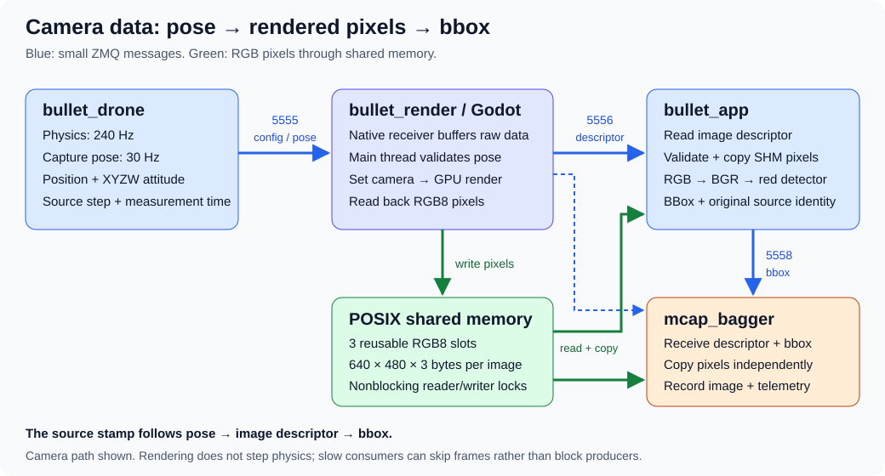
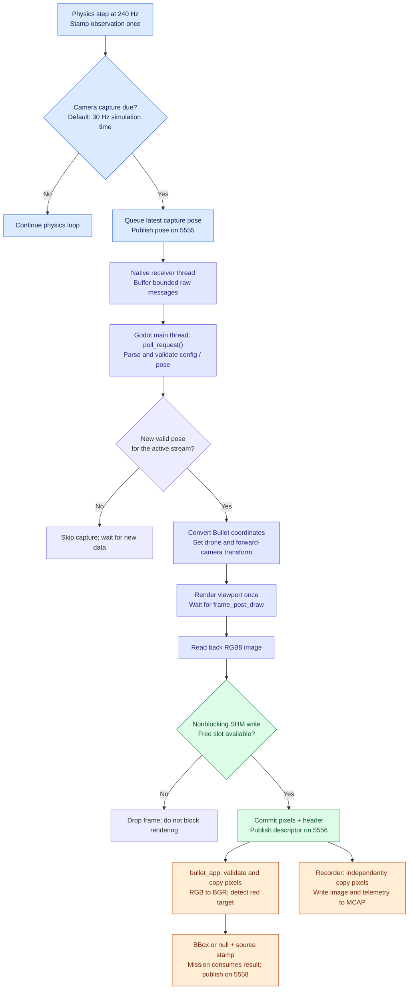
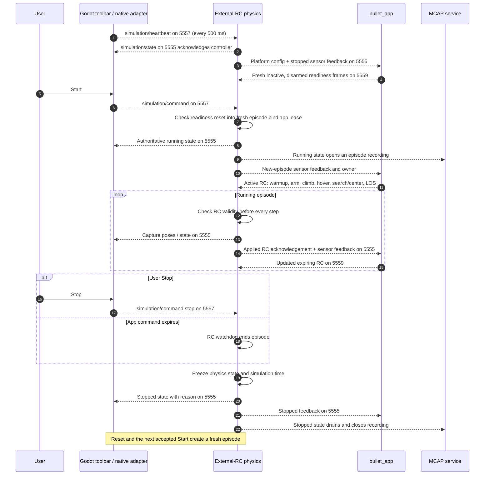

# Bullet Render — native Godot / ZeroMQ camera

This project is a member of the [Bullet workspace](../README.md). All six
projects share `../.venv` and `../uv.lock`; run uv commands with the
workspace flags below to retain every project and optional dependency.

Godot renders a landscape and forward camera from `bullet_drone` ground-truth
poses. The native C++ adapter receives JSON telemetry over loopback ZMQ TCP and
publishes image descriptors over TCP, with RGB8 pixels in POSIX shared memory.
Sibling `bullet_msgs` owns the shared schemas, wire contract and SHM reader.
Sibling `bullet_app` provides the live camera/bounding-box preview with `--debug`.

A parked red delivery truck sits **50 m ahead of the physics origin** (horizontal
ground distance, Bullet X=50 m / Godot Z=−50 m), following the terrain slope. The
drone spawn stays at its physics position. The default spectator view is wide
enough to include both; right-drag or scroll to inspect the truck. Scenery,
including the truck, has no Bullet collision body. Godot detects truck contact
to end app-owned episodes without applying collision forces.

## Visual overview



Physics owns simulation time, camera settings and capture cadence. Godot owns
the landscape, camera transform, rendering and GPU readback. The app owns target
detection and mission/LOS control. The diagram shows the camera data path; the
control path is separate: Godot lifecycle commands use **5557**, while app RC
intent uses **5559**. Endpoint numbers and camera settings are configurable.

### Render flow



The receiver worker only buffers raw messages. Parsing, scene changes, capture
and image publication happen on the Godot main thread. A `busy` guard keeps
only one capture/readback in flight; newer pending poses can replace older ones.
The queues and nonblocking locks favor current data over a growing backlog.
Camera configuration repeats once per second independently of capture cadence.

### Pose-to-image sequence

```mermaid
sequenceDiagram
    autonumber
    participant P as bullet_drone
    participant R as Native receiver worker
    participant G as Godot main thread
    participant GPU as GPU / viewport
    participant S as SHM slots
    participant A as bullet_app
    participant M as mcap_bagger
    P->>R: render/drone_1/config on 5555 (periodic)
    R->>R: Store raw config in protected slot
    loop Capture due at configured simulation cadence
        P->>R: render/drone_1/pose on 5555 (position, attitude, source)
        R->>R: Replace latest raw pose slot
        G->>G: poll_request(): take slots under lock, parse and validate
        G->>G: Convert frames; apply pose and camera settings
        G->>GPU: Render SubViewport once
        GPU-->>G: frame_post_draw; texture available for RGB8 readback
        G->>S: Try exclusive slot lock; write pixels and complete header
        alt All slots busy
            G->>G: Drop this frame; continue without blocking
        else Frame committed
            G-->>A: camera/front/image descriptor on 5556
            G-->>M: Same descriptor on 5556 (independent subscriber)
            par App image processing
                A->>S: Try shared lock; check identity and sequence; copy pixels
                S-->>A: Owned RGB pixel bytes, or skip if unavailable/reused
                opt Complete frame received
                    A->>A: RGB to BGR; red segmentation; bbox or null
                    A->>A: Vision worker stores latest metadata and bbox
                    A-->>M: Mission thread publishes tracking/front/bbox on 5558
                end
            and Recorder image processing
                M->>S: Try shared lock; validate and copy pixels
                S-->>M: Owned pixel bytes, or skip
                opt Complete frame received and episode recording active
                    M->>M: Queue and write image to MCAP
                end
            end
        end
    end
    Note over P,A: Stamped path preserves physics / episode / stream / step / measurement time
    Note over G,S: capture_ns = source.measurement_us * 1000; SHM binary header stays v1
```

This is asynchronous publication, not a blocking render request/reply protocol.
Physics can advance while the selected pose renders. App and recorder read the
same slots independently; a successful notification submission does not prove
either consumer received or copied the frame. Invalid/busy/reused frames can
be skipped before detection or recording.

The **source stamp**, rather than arrival time or matching publication counters,
associates pose, image and bbox. For full message fields, see
[image-to-bbox data flow](../los_tracking/docs/image-to-bbox-data-flow.md).

## Build

Prerequisites on Ubuntu 24.04: Godot 4.7, GCC with C++20, CMake, Ninja, pkg-config,
libzmq development headers (tested with 4.3.5), Python 3.12 and uv. No Rust build is
needed. If libzmq headers are missing, install `libzmq3-dev` through your package
manager. Godot-cpp remains pinned to Godot 4.5 stable and is fetched by CMake.

```bash
uv sync --locked --all-packages --all-extras --all-groups
cmake --preset debug
cmake --build --preset debug
```

Unchanged configure/build runs reuse the existing bindings and extension; real
source, profile or build-setting changes still trigger the required rebuild.

The output is `godot/bin/libzmq_camera.so`, linked to system libzmq and the shared
C++ runtime. Sharing that runtime avoids initialization collisions with Mesa/LLVM
on Intel graphics. CMake imports
the extension into Godot; a one-second frame delay avoids Godot's cold-import
shutdown race (upstream issue #111048). Generated files remain ignored.

Keep the sibling `bullet_msgs` checkout alongside this repository. Prepare consumers:

```bash
cd ../bullet_drone
uv sync --locked --all-packages --all-extras --all-groups
cd ../mcap_bagger
uv sync --locked --all-packages --all-extras --all-groups
cd ../bullet_app
uv sync --locked --all-packages --all-extras --all-groups
```

## Launch

Run these in separate terminals, from the indicated directories. The recorder
waits for physics to report a running simulation before creating a file.

```bash
# mcap_bagger
uv run --locked --all-packages --all-extras --all-groups mcap-bagger --config ../bullet_render/configs/recorder.yaml
```

```bash
# bullet_render; NVIDIA PRIME offload verified on the RTX 5070 Laptop GPU
./tools/run_godot.sh --path godot
```

```bash
# bullet_drone
uv run --locked --all-packages --all-extras --all-groups python -m examples.external_rc.main \
  --render-config ../bullet_render/configs/physics.json
```

Use workspace task **Bullet: Run all** to build the native renderer and launch
`bullet_app`, Godot, external-RC `bullet_drone` physics and the episode recorder in one terminal.
Recording is enabled automatically, with process logs under `recordings/launch_<UTC>/`. Wait for `Mission READY`, then press Start in Godot. Exiting any
service stops the remaining services. PlotJuggler and the standalone video viewer
are not launched by this task.


## Simulation toolbar

All four physics example CLIs start **Stopped** and stay alive between runs.
In Godot's bottom-left toolbar, the play triangle starts a fresh episode, the
stop square ends the run while keeping its final pose, and the reset arrow
restores the initial pose at time zero and waits. Normal mission completion also
returns to Stopped. Click or tab to a button and press Enter/Space.

Godot broadcasts commands on loopback TCP **5557**, and physics acknowledges actual lifecycle state. The external-RC example also
requires fresh app readiness before Start. The toolbar shows actual physics state from telemetry, not
an optimistic click result. It remains disabled until physics sees this Godot
controller's heartbeat. A missed command may require another click. Three seconds
without Godot's 500 ms heartbeat ends an active run; reconnecting never auto-starts.

### Lifecycle and app-control sequence



The toolbar reflects acknowledged physics state. It does not start physics by
moving a scene node. Truck collision has its own confirmed termination path
(described below); a rendered overlap is a proposal until physics confirms it.

The held pose is republished once per second while stopped, including for late
viewers. Physics steps and simulation time remain frozen. Errors end the episode
and appear in status; Start/Reset attempts a fresh reset.

The MCAP service creates one file when physics reports a running episode, including
when it joins an ongoing run. Stop, Reset, mission completion, physics errors, or
three seconds without valid physics state drains and closes the file. Reset does
not open another file. Repeated Start keeps the current file. A closed or failed
episode is never reopened by delayed state messages; the next episode gets a new
file. Recording failures leave `.mcap.partial` files and do not stop physics. The
manual recorder prompt remains available by omitting `--config`. Recording is best
effort: waiting for running state and PUB/SUB delivery can miss initial/final samples.

## Transport and interfaces

`configs/transport.json` holds distinct loopback TCP endpoints for telemetry, images,
and control (`control_endpoint`). Publishers bind;
subscribers connect and automatically reconnect. No broker is needed.

| Publisher | Endpoint | Topic and payload | Subscribers |
| --- | --- | --- | --- |
| Physics | `tcp://127.0.0.1:5555` | `render/drone_1/config`, JSON repeated every second | Godot |
| Physics | Same port 5555 | `render/drone_1/pose`, JSON at 30 Hz simulation time | Godot, MCAP, PlotJuggler |
| Godot | `tcp://127.0.0.1:5557` | `simulation/command` and `simulation/heartbeat`, JSON | Physics, future consumers |
| Physics | Same port 5555 | `simulation/state`, JSON | Godot, future consumers |
| Godot | `tcp://127.0.0.1:5556` | `camera/front/image`, SHM descriptor | bullet_app, MCAP, video viewer |
| Physics | Same port 5555 | `flight/drone_1/config`, `flight/drone_1/feedback`, JSON | bullet_app, MCAP |
| App | `tcp://127.0.0.1:5559` | `flight/drone_1/rc`, expiring 18-channel RC JSON | External-RC physics, MCAP |
| App | `tcp://127.0.0.1:5558` | `tracking/front/bbox`, `app/drone_1/mission`, `tracking/front/los`, JSON | MCAP, plotting/viewing consumers |

Physics runs at 240 Hz. Its configured capture/pose rate remains 30 Hz; physics
owns camera settings and cadence. Config/pose telemetry retains exactly two parts,
topic and JSON. Image notifications are a single message containing exact topic
plus NUL, little-endian uint32 JSON length, and descriptor JSON, with no pixels.
The old IPC/socket-pixel wire format is replaced and all components must migrate
together. Configurable TCP ports are supported; all image consumers must share
the renderer's Linux host/user.

App-owned physics publishes **pose v3** with a `source` observation stamp;
legacy examples retain **pose v2** without that stamp. Both include
`linear_velocity_m_s: [vx, vy, vz]` in Bullet world coordinates (m/s, Z up), from
the same snapshot as position and attitude. Stamped poses produce **image
descriptor v2** and stamped bbox v2; legacy image descriptors remain v1. The
**binary SHM header stays v1** in both cases. Strict consumers reject pose v1
or missing velocity; old MCAP files retain their original embedded schemas.

For the stamped flow, `source` is preserved from pose through image descriptor
to bbox, and `capture_ns = source.measurement_us * 1000`. That time identifies
the physics observation used for rendering, not GPU completion or Unix arrival.
Pose and image publication sequences are independent counters.

Godot allocates three 0600 POSIX SHM slots after learning camera dimensions.
Writers take nonblocking exclusive locks; readers take nonblocking shared locks
and copy pixels before unlocking. Busy, incomplete, reused and missing slots are
skipped, so neither recorder nor viewer blocks rendering. Unique sessions permit
renderer restart. Normal close unlinks owned objects; abrupt kill can leave
orphans requiring exact-session cleanup. See [bullet_msgs](../bullet_msgs/README.md)
for the header layout, validation rules and cleanup instructions.

`ZmqCameraAdapter` provides `start(transport_path)`, `poll_request()`,
`publish_frame(pixels, request)`, `get_stats()` and idempotent `close()`.
`publish_control(action)` only enqueues a local event; `get_control_state()` returns
the latest valid physics state or an empty dictionary after three seconds without
a valid state. Lifecycle publication stays on the native worker; image publication runs on
the main thread.
Statistics add `shm_session`, `busy_slots` and `publication_drops`; `frames` counts
accepted notification submissions, not consumer deliveries. Worker threads never
access Godot objects. Camera dimensions remain fixed for a renderer run.

Telemetry high-water marks remain 64 messages, image descriptors 8. Zero linger
and nonblocking publication remain in place. The recorder uses `input: shm_image`,
copies pixels into its bounded 64 MiB queue, and reports skipped SHM images.
Malformed data and queue overflow fail recording rather than hiding accepted-data
loss. ZMQ can also drop notifications before receipt, which counters cannot fully
observe. The recorder now preserves an exact image identity sidecar, `camera/front/image/metadata`, linked by image log time and record sequence. Use the
stamped source identity when available.

Start the camera/bbox preview (or use workspace **Bullet: App (debug)**):

```bash
cd ../bullet_app
uv run --locked --all-packages --all-extras --all-groups bullet-app --transport-config ../bullet_render/configs/transport.json \
  --mission-config ../los_tracking/examples/bullet_profile.json --debug
```

The app supports one exact topic per process, dimensions from descriptors,
bounding boxes and stream status, reconnect, and Q/Esc/window-close exit. Godot still performs
GPU readback; scenery remains visual with no Bullet collision geometry.

## Checks and benchmark

```bash
uv run --locked --all-packages --all-extras --all-groups pytest -q
godot --headless --path godot --script test_frames.gd
./tools/run_godot.sh --path godot --script test_scene.gd
__NV_PRIME_RENDER_OFFLOAD=1 __GLX_VENDOR_LIBRARY_NAME=nvidia \
  uv run --locked --all-packages --all-extras --all-groups \
  python tools/check_pipeline.py --seconds 60 --report-dir /tmp/bullet-zmq-check
# Add --fault-checks for late recorder startup, physics pause, slow Godot and restart.
# Check the automatic recorder service with Start, Stop, Reset and physics loss:
__NV_PRIME_RENDER_OFFLOAD=1 __GLX_VENDOR_LIBRARY_NAME=nvidia \
  uv run --locked --all-packages --all-extras --all-groups \
  python tools/check_recording_controls.py --report-dir /tmp/bullet-recording-controls
```

The pipeline check independently reads MCAP images/poses, checks camera bytes and
arrival timestamps, and reports FPS, CPU usage (100% = one core), queue peak and
last observed native counters. Logs and a camera preview remain in the report
directory; temporary recordings are deleted. Mean capture/readback and publication
timings are sampled in periodic Godot logs. The final snapshot may precede shutdown.

Historical socket-pixel performance results are recorded in [BENCHMARK.md](BENCHMARK.md); they are not SHM measurements. The source rate
caps delivered FPS at 30, and mission restart gaps reduce the full-run average.

Migration validation results are recorded in sibling
[plan 0023](../bullet_drone/plan/0023-zmq-tcp-shm.md). The real-render pipeline check
writes its logs, independent MCAP readback report and camera PNG under the report
directory. Full performance tuning is outside this migration.

Simulation-control validation and limits are recorded in
[plan 0024](../bullet_drone/plan/0024-godot-simulation-controls.md).

### Bullet application detections

The sibling `bullet_app` receives camera images, calls `los_tracking`, and publishes
`tracking/front/bbox` JSON on loopback port 5558. The recorder profile records it
with `bullet_msgs:bbox.json` during each episode. **Bullet: Run all** launches
the application in debug mode with bounding boxes.
Run `uv sync --locked --all-packages --all-extras --all-groups` in `../bullet_app` before using these tasks; see the
[application README](../bullet_app/README.md) for the standalone command.

## App flight verification

The workspace task prompts for the navigator profile: choose
`../los_tracking/examples/bullet_profile.json` for the usual LOS mission or
`../config/betaflight.json` for the tuned Betaflight altitude loop. It saves
MCAP files under `~/workspaces/bullet/recordings`. Wait for app READY, then press
Godot Start: warmup, arm, climb 20 m relative to the initial barometer, settle
for 3 s and wait for a fresh post-hover bbox before LOS. Missing bbox starts a
15 deg/s yaw search for one measured full circle; expired RC or LOS faults freeze
physics. Renderer-confirmed truck contact completes the scenario; landing is not inferred. See [app mission details](../bullet_app/README.md).

With a real graphics display, run the isolated-port check:

```bash
uv run --locked --all-packages --all-extras --all-groups python tools/check_app_flight.py
```

It launches physics, app, Godot and MCAP, checks the mission through LOS, kills
the app to verify the expiry watchdog freezes physics, and reads back the bag.
Logs/report are retained in `/tmp/bullet-app-flight`; temporary bags are removed.
The native adapter preserves source pose/feedback identity in descriptor v2,
using the measurement timestamp for capture_ns; binary SHM remains v1.

## Truck collision and completion

In app-owned flight, Godot checks a **0.42 m drone sphere** against convex
colliders derived from individual red-truck meshes. Initial overlap and swept
queries detect contact even when poses skip past the truck. Collision queries run
on the main physics thread, independently of GPU readback. Terrain, trees and
rocks remain outside detection; there is no impact force, bounce or landing.

Godot reports `render/drone_1/collision` on existing port 5557. Physics validates
controller/episode identity and the stamped source against its recent history,
freezes before another step and publishes `scenario/ended` on port 5555.
Simulation state v2 embeds the same success/target_hit result. The app latches
COMPLETED, withdraws RC intent, and Godot shows **Completed / Target hit**. All
processes stay open. Start or Reset clears the result for a fresh episode.

Reports retry every 100 ms. Without confirmation after one second, Godot displays
an acknowledgement failure and requests ordinary Stop; it does not claim success.
The confirmed result repeats for late subscribers. Its contact source and final
frozen physics source are separate: physics may advance during report delivery
and is not rewound to the contact point.

The recorder stores raw proposals and one confirmed event per event ID, then
allows 250 ms for final feedback/app diagnostics before closing. A stopped-state
snapshot also supplies the result if the standalone event was missed. Arrival
RawImage timestamps still do not establish exact image/pose association.

```bash
# Real-display deterministic source trajectory through production RC/lifecycle wiring.
uv run --locked --all-packages --all-extras --all-groups python tools/check_collision.py
# Discard all collision reports: verify timeout, Stop and absence of false success.
uv run --locked --all-packages --all-extras --all-groups python tools/check_collision.py \
  --reject-collisions --report-dir /tmp/bullet-collision-timeout
# Geometry alone (headless does not validate pixels).
godot --headless --path godot --script test_collision.gd
```

The integration probe substitutes deterministic observations for physical motion;
collision detection, transport, physics-loop termination, app and recorder use
production code. It deliberately drops the first report to verify retry. This
checks termination without requiring LOS tuning to navigate into the truck.
Logs/report and a completion screenshot remain in `/tmp/bullet-collision/`;
temporary recordings are removed. The separate square examples retain their
legacy lifecycle and do not enable this stamped-pose collision flow.

## LOS graph and MCAP topic

The mission app publishes **tracking/front/los** on the existing port5558, and
`configs/recorder.yaml` records it alongside the other app/physics streams.
It contains bearing in **degrees**, LOS rate in **degrees/second**, TTC in seconds,
fit validity/reason/residual, timestamps and mission/navigation state. Steady
samples are30Hz; state changes are immediate. Existing mission diagnostics remain
in radians. See [app telemetry fields](../bullet_app/README.md).

The real-display checks validate the stream in MCAP:
`tools/check_app_flight.py` compares sampled degrees with existing radian mission
diagnostics, and `tools/check_collision.py` checks the final inactive LOS marker
is saved within the250ms collision-finalization drain. Test bags are temporary;
normal task recordings still save to `recordings/`.

## Scenario starting position

Use the **external RC** physics task, open **Scenario**, then **Pick position on
landscape** and left-click any ground point in the full 500 × 500 m landscape.
Right-drag or scroll to find a location; zoom out and orbit overhead to reach the
whole landscape. UI clicks do not select ground. The panel shows Bullet X/Y;
**World Z** is the absolute altitude in metres, matching the barometer frame.
It is not height above terrain. Each ground selection automatically fills Z
with the local triangle height plus 0.015 m clearance, rounded upward to the
next millimetre. You can adjust Z afterward to start higher. Allowed world Z is
0.015–500 m, with 0.001 m input steps; below-terrain starts remain blocked.

Yellow marks the draft; green marks the confirmed applied spawn. **Apply** creates
and previews a new stopped episode. The actual drone moves only when physics
publishes its confirmed pose. **Start** and **Reset** reuse the applied position.
Selection/Load/Apply are disabled while running; a pending Apply also blocks
Start/Reset. Initialization failure retains the previous usable simulation.
A request retries every 100 ms for 2 s, then shows unconfirmed while reconciling
with authoritative physics status; a lost acknowledgement never implies success.
Other physics examples retain their existing controls without spawn support.

Set **Takeoff height (m)** to the climb above the initial barometer altitude
(default 20 m, range 0.1–100 m). Apply confirms both the starting position and
takeoff height; changes take effect in the next episode.

Choose a custom name and **Save preset** to persist position and takeoff height in
`user://spawn_scenarios.json` (Godot's per-user application data directory).
**Load draft** never moves physics; Apply is explicit and rechecks the current
terrain. Default `(0, 0, 0.015)` is read-only. Presets use versioned JSON and atomic
replacement; existing v1 presets load with a 20 m takeoff height; invalid files/write failures are reported without replacing the
last valid presets. They are local user data and are not checked into Git.

Attitude starts at identity and velocities at zero. The app still warms sensors,
arms, then climbs the **configured height above the initial barometer reading**
and hovers for 3 s. With the default 20 m climb, Z=5 m gives a target near Z=25 m. Elevated starts can briefly fall
before arming/thrust. The terrain collider is for picking only: landscape hills
remain visual geometry rather than physical ground/contact obstacles.

`simulation/spawn_request` shares lifecycle port 5557. Authoritative
`simulation/spawn_state` repeats on telemetry port 5555 at 10 Hz, including while
stopped, and the default recorder stores it in each running episode's MCAP.
Stopped preview alone does not start a recording. Renderer restart recovers the
applied configuration; restarting physics restores the default spawn.

Checks (the integration needs a real graphics display):

```sh
godot --headless --path godot --script test_spawn.gd
uv run --locked --all-packages --all-extras --all-groups python tools/check_spawn.py
```

The integration exercises a real screen click, Apply/Start/Reset, renderer
restart, a selected 6 m takeoff and MCAP readback. Report, logs and a panel screenshot
remain in `/tmp/bullet-spawn/`; integration bags are temporary.

Yaw-search display/MCAP checks use isolated ports and temporary recordings:

```bash
uv run --locked --all-packages --all-extras --all-groups python tools/check_app_flight.py --yaw-search found --report-dir /tmp/bullet-yaw-found
uv run --locked --all-packages --all-extras --all-groups python tools/check_app_flight.py --yaw-search empty --report-dir /tmp/bullet-yaw-empty
```

The test probe prepares a terrain-cleared scenario behind the truck using the
existing panel and Apply acknowledgement. The first case verifies search, horizontal centering within +/-10 pixels, yaw
settling, centered-heading LOS acquisition/approach and the app-loss watchdog; the
second hides the rendered truck and verifies full-circle exhaustion/freeze.
Reports, screenshots and logs are retained in the specified report directory.

### Camera latency checks

Godot selects the latest pending pose when idle, applies the camera transform
immediately and renders with `RenderingServer.force_draw(false)`. Camera
readback and SHM publication complete before the normal window presentation,
so a delayed swap cannot hold an already selected camera pose. Physics still schedules poses at
30 Hz; SHM has no separate timer and never waits for readers.

Every five seconds, `Native camera stats` reports windowed mean, p95 and maximum
for `render_wait_ms`, `readback_ms`, `capture_ms`, `publish_ms` and `source_age_ms`.
Source age uses the original physics measurement clock, including time before
Godot received the pose. Stopped physics intentionally produces old source ages;
compare these statistics during a running episode. `busy_slots` and
`publication_drops` identify nonblocking image drops.

The app reserves 20 ms of remaining image validity for its next 100 Hz command
tick and transport. Navigation enters recovery (`image_deadline`) before an
image-limited command expires between ticks. The 100 ms image freshness limit,
command expiry enforcement and process-loss watchdog remain in effect.

Run timing summary checks with
`godot --headless --path godot --script test_camera_timing.gd`. The real-display
`tools/check_app_flight.py` check exercises acquisition, image-gap recovery,
reacquisition and the process-loss watchdog.

### NVIDIA PRIME display path

Use `./tools/run_godot.sh --path godot` or **Bullet: Run all**. The launcher
selects NVIDIA PRIME with the NVIDIA GLX driver on X11 and disables application
vsync. The production scene rejects an Intel/software renderer instead of silently
running on it. Real-display test tools use the same launcher; headless checks
and capture-only visual fixtures remain available separately.

`prime-select query` distinguishes system profiles. `on-demand` keeps the desktop
on Intel and offloads Godot to NVIDIA, so presentation still crosses GPUs.
To use the NVIDIA system profile, run `sudo prime-select nvidia`, then log out
and back in (or reboot). Verify the new session with `prime-select query`,
`xrandr --listproviders`, Godot's GPU startup line and `nvidia-smi`. The hardware's
physical display wiring can still require an Intel output sink. Re-run the camera
timing/flight checks after changing the session; launch flags cannot certify that
system-level presentation latency is fixed.

## Live wind and windsock

In the external-RC/LOS workflow, **Wind** beside **Scenario** toggles a separate
settings panel. Opening it does not send a command. Edit enabled state, world XYZ
mean velocity in m/s (+Z up), correlated gust XYZ standard deviation in m/s,
positive correlation time in seconds and integer seed, then **Apply wind**.
The vector points downstream, toward air travel. Standard deviation is statistical
variation, not a gust limit. Applied mean and current mean-plus-gust air velocity
come from physics, using existing ports and ownership/retry checks.

Apply works running or stopped; stopped edits do not advance time. Mean/gust/tau
edits preserve gust history; seed or enable/mode changes restart it. Start/Reset
and spawn changes keep settings and restart gusts. Physics restart reloads YAML;
GUI changes are not saved. Other physics examples display unavailable controls.

A procedural 3 m pole and 2 m windsock sits beside the confirmed spawn, +8 m
world Y, grounded on the visual terrain. It follows the full authoritative wind
vector, hangs down below 0.1 m/s and turns gray with “Wind unavailable” on stale
readback. It uses spectator layer 2 with no collision or shadows and is excluded
from the drone camera. Godot generates neither wind physics nor random gusts.

Checks: `godot --headless --path godot --script test_wind.gd`,
`./tools/run_godot.sh --path godot --script test_wind_scene.gd` (display required),
and `uv run --locked --no-sync pytest -q tests/test_native_adapter.py tests/test_live_wind_pipeline.py`.

## Automatic flight analysis recording

**Bullet: Run all** builds the renderer and runs `tools/run_flight.py` in the
shared uv environment. It starts the recorder before flight services, creates
one MCAP for each running episode and stores separate `app.log`, `physics.log`,
`godot.log` and `recorder.log` files under `recordings/launch_<UTC>/`. MCAP health
metadata includes that launch ID. The launcher drains the recorder after stopping
other services. Existing recordings are never overwritten or automatically deleted.
Do not launch another recorder separately when using this task.

The normal profile now includes wind, simulation state, actual ground truth
(100 Hz), available sensor outputs (physics sampling rate), physics/app config
snapshots (1 Hz), and renderer counters (1 Hz). Images retain original frame/source
identity in a paired metadata channel. Diagnostic streams use existing endpoints;
none feed ground truth into the app controller or change clipping behavior.

Generate an offline report without modifying any flight settings:

```bash
uv run --locked --all-packages --all-extras --all-groups python -m mcap_bagger.report \
  recordings/<flight>.mcap --output /tmp/flight-analysis --csv
```

Open `/tmp/flight-analysis/report.html`. It identifies the first recorded
`clipped_target`, the exact rejected image when available, nearby images, commands,
wind, sensor errors and ages. `report.json` keeps the analysis window and source
stamps; optional `telemetry.csv` flattens the same window. Legacy files work but
report missing identity/diagnostics rather than guessing an exact image match.

### Betaflight SITL backend

Set `control.backend: betaflight` in the selected physics YAML and first run
`../bullet_drone/tools/setup_betaflight_sitl.sh`. The normal `run_flight.py`
launcher then owns the pinned firmware process, restarts it for each episode and
passes its private control endpoint to physics. Physics exchanges FDM/motor UDP;
the app sends RC and reads attitude, altitude and status over MSP TCP port 5761.
Godot continues to render physical ground truth. `analysis/app/msp` records the
firmware estimates, status, host receipt times and RC-link counters in MCAP.

Run a hover-only check with `python tools/run_flight.py --physics-config
../config/basic.yaml --hover-check`, then click Start in Godot. The app stops
after 20 stable seconds at 20 m relative altitude. For an automated isolated
SITL check and MCAP ground-truth envelope report, run
`python tools/check_app_flight.py --physics-config ../config/basic.yaml
--hover-check --report-dir /tmp/bullet-bf-hover`.

The workspace tasks select `../config/basic.yaml`, which currently uses `betaflight`, so
the normal tasks start firmware. Set its backend to `internal` to use the native
simulation controller. SITL failures and firmware stdout are saved in the
launch's `sitl.log`.

The VS Code **Bullet: Run all** tasks first run `python3 tools/cleanup_flight.py`.
It gracefully stops stale launcher, renderer, app, physics, recorder and pinned
SITL processes from this workspace, then verifies the flight ports are free. It
does not terminate similarly named processes from another checkout. Use
`python3 tools/cleanup_flight.py --dry-run` to inspect what it would stop.

### Configure the MCAP directory

**Bullet: Run all** now reads `../bullet_app/configs/app.json`. Its
`recording.output_dir` controls future MCAP files only, with relative paths based
on the app configuration file. The supplied configuration uses `../recordings/` in the shared workspace.
The recorder YAML's output directory remains the standalone-recorder fallback.

From this directory, use a different destination for one launch:

```bash
uv run --locked --all-packages --all-extras --all-groups python tools/run_flight.py \
  --mcap-output-dir /data/flights
```

`--app-config PATH` selects a different app configuration; the CLI directory wins
over the file and is working-directory-relative. Absolute paths and `~` work.
The recorder creates/checks the directory before readiness. Any failure aborts
launch before Godot, physics and app start. Logs remain under
`recordings/launch_<UTC>/`; filenames, episode recording and shutdown are unchanged.

To check the normal mission with the workspace Betaflight tuning profile:

```bash
uv run --locked --all-packages --all-extras --all-groups python tools/check_app_flight.py \
  --physics-config ../config/basic.yaml --mission-config ../config/betaflight.json \
  --report-dir /tmp/bullet-betaflight-flight
```

The app prints MSP attitude request/response/publication/consumption rates once
per second and records delivery timing in `analysis/app/msp.attitude_delivery`.
The hover-check mode continues to select its dedicated profile.
